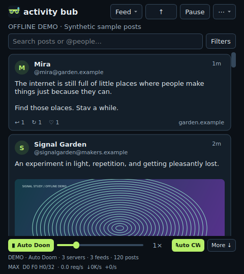

<p align="center"></p>

# Activity Bub 😎

**A thousand little worlds. One very good rabbit hole.**

A native desktop Fediverse explorer. Activity Bub discovers servers through
public peer lists and blends readable feeds into a centered, compact scroll.
No account, hosted backend, or API key is required for its public feeds.



*Screenshot uses clearly labeled synthetic demo posts.*

## Get rolling

Download a portable build from the repository's Releases page, extract the
**whole folder**, and run `Activity-Bub` on Linux or `Activity-Bub.exe` on Windows.
Portable builds include the runtime; Python installation is unnecessary.

For source installs, use Python 3.11+:

```bash
chmod +x run.sh
./run.sh
```

First launch creates a virtual environment and installs Qt Essentials, psutil, and Pillow. On
Windows, double-click `Activity-Bub.bat`. A Linux application-menu shortcut is
available through `./install-desktop.sh`. Run `./run.sh --demo` for the offline
preview. See [portable notes](docs/PORTABLE.md) for platform requirements.

## What's inside

- **Explore:** persistent recursive server discovery, NodeInfo detection, public
  peer lists, a server radar, and seed import/export. No daily discovery cap.
- **Scroll:** mixed public posts, whole-image scaling that fits the window,
  deduplication, history pagination, smooth wheel scrolling, nearby-image
  preloading, and a reader on demand. Previews warm two viewports ahead and one
  behind in the direction you scroll; visible images get priority. Touchpad
  pixel motion remains direct, with no extra animation over native momentum.
- **Auto Doom:** hands-free scrolling with a 0.25×–4× speed slider in the existing
  footer. It fills from cache and waits for new posts at the end. Wheel scrolling,
  keyboard navigation, scrollbar movement, or opening a reader pauses it.
- **Auto CW:** optional automatic reveal of content warnings and sensitive media
  in the feed and reader. This also permits nearby preview preloading. Turning
  it off re-covers automatic reveals; manually revealed posts remain revealed.
  The Hide CW filter continues to exclude matching posts.
- **MAX:** 32 independent crawler jobs by default, federated public timelines,
  continuous peer discovery, and an unread history buffer. A compact footer
  shows discovery/live/history jobs, requests per second, download rate, and
  unique new posts per second. Click it for the engine room.
- **Make it yours:** six saved color themes, from lime and violet to a light
  paper palette. Search, language/media/CW filters, muted phrases, authors,
  servers, and local bookmarks.
- **See and read comfortably:** saved blue/yellow, red-sensitive, green-sensitive,
  monochrome, and warm colors; dark/light high contrast; 100–200%
  text size; reading fonts; bold text; larger controls; reduced motion; and
  image-free reading with attachment descriptions. Screen-reader mode provides
  a native text feed and stops animated scrolling. Color and contrast filters
  also apply to feed and reader images by default; originals remain available
  by switching image filters off. [Accessibility guide](docs/ACCESSIBILITY.md).
- **Collect worlds:** an optional local passport with XP, six ranks, and eight
  badges. Reading a new server gives 25 XP; a first-time save gives 10 XP.
  Reopening the same server or toggling a bookmark does not farm points.
- **Get pleasantly lost:** Surprise me jumps to a random cached post while
  respecting filters and mutes.

Themes, accessibility, passport, Surprise me, discovery, and Preferences live in the **⋯** menu.
Feed / Saved / Server radar are in the view menu. The window starts around 800
pixels wide and resizes down to 460 × 400, with a centered 720-pixel feed limit.

## Controls

| Key / control | Action |
| --- | --- |
| Scroll / More ↓ | Load more cached posts, then request older public pages |
| Auto Doom / D | Start or pause automatic scrolling |
| Speed slider | Change Auto Doom speed from 0.25× to 4× |
| Auto CW | Toggle automatic CW/sensitive-content reveal |
| Click / Enter | Open the selected post's full reader |
| Esc | Return from the reader |
| B | Save or unsave the selected post |
| Ctrl+O | Open the original in your browser |
| Ctrl+J | Surprise me |
| Ctrl+F | Search downloaded posts |
| Ctrl+Alt+A | Open accessibility settings |
| Ctrl+Plus / Ctrl+Minus / Ctrl+0 | Enlarge, reduce, or reset text size |
| F6 | Move keyboard focus to the feed |
| R / ↑ | Refresh from the latest cached posts |
| Space / Pause | Pause or resume new requests |

New finds wait behind the toolbar's count instead of moving your reading
position. When you reach the end of cached history, unread arrivals join the
bottom even if their timestamps are newer. R returns to a chronological view.
Audio, video, and full attachments open in your normal browser.
Content warnings remain covered until you reveal the post or enable Auto CW.
Speed and Auto CW are remembered; Auto Doom starts off on every launch. The
1× pace is 60 pixels per second. Cached history status is available on More ↓'s
tooltip; the status line indicates when Auto Doom is buffering.

## Local by design

The cache, mutes, theme, bookmarks, and passport stay on your computer. Rewards
can be switched off from the passport. There are no remote leaderboards,
analytics, extra reward-related requests, or accounts.

| Platform | Default data folder |
| --- | --- |
| Linux | `$XDG_DATA_HOME/activity-bub` or `~/.local/share/activity-bub` |
| Windows | `%LOCALAPPDATA%\ActivityBub` |
| macOS source | `~/Library/Application Support/ActivityBub` |

Close the app before backing up that folder. Replacing the application folder
retains this data. The cache keeps about 50,000 recently fetched unsaved posts,
plus bookmarks; it is a rolling cache rather than a permanent archive.

## Turn it up

Choose **Power** in the ⋯ menu, or click the footer meter. The setting is saved.

| Profile | Discovery jobs | Live jobs | History jobs | Unread buffer target |
| --- | ---: | ---: | ---: | ---: |
| Quiet | 2 | 4 | 2 | 400 |
| Balanced | 5 | 8 | 3 | 900 |
| MAX (default) | 10 | 16 | 6 | 1,800 |

Separate pools let live feeds continue while discovery waits on slow servers.
MAX polls quiet feeds roughly every nine seconds, busy feeds every two seconds,
and older pages every four seconds while the buffer needs more posts. History
has its own timer. New-server validation writes in small batches so large peer
lists do not hold the database lock for one huge transaction.

Federated mix requests each server's public network timeline, merging and
deduplicating remote posts too. When a server permits only public local reads,
Activity Bub uses that capability. Switch **Include federated public posts** off
for local timelines only. Restricted network previews are remembered per server.

The controller lowers concurrency under CPU/RAM pressure or UI stalls, then
recovers gradually. It caps crawler jobs at 32, media jobs at four, and request
starts at 48 per second across the app, with one-second per-host spacing.
Already-running work drains when a budget falls. The engine room includes
active HTTP requests, response latency, total errors/cooldowns, CPU, resident
RAM, and actual process threads. CPU/RAM counters can be unavailable on some
systems; UI-lag feedback still works. Download rates count received response
payload bytes, not TLS/header overhead. All counters stay local.

Retry-After, retry backoff, TLS verification, public-IP pinning, and response-size
limits apply. HTML becomes plain text; remote SVG/HTML is not rendered as image
data. Raster previews decode in disposable restricted processes, then enter the
GUI as raw RGBA pixels. Original metadata and file trailers are discarded.
Servers you query
see your IP address and the app's User-Agent, as with any direct client.

Original previews use a 64 MiB memory budget, with another 16 MiB for fitted
display sizes. Pending image jobs are capped at eight. Fast scrolling replaces
stale queued image jobs; already-running requests finish normally. Covered CW
and sensitive media are excluded from preloading until manually revealed or
the user enables Auto CW. All revealed previews use the same restricted decoder.

Preview isolation currently requires Linux x86-64 or arm64 with seccomp support;
the packaged policy has been exercised on x86-64 here. Windows, macOS, and
unsupported systems keep remote previews disabled. There is no in-process
fallback or unsafe-preview switch. Text browsing and browser links still work.
Only PNG, JPEG, GIF (first frame), WebP (first frame), and BMP are accepted.
TIFF, AVIF/HEIF, SVG, documents, and executables are rejected as previews.

Each image is limited to 5 MiB input, 16 million source pixels, 3 CPU seconds,
512 MiB process address space, and 6 seconds of wall time. At most two decoder
processes run simultaneously. Pixel output is bounded and validated before GUI
allocation. The worker cannot open files, create sockets, fork, or exec after
its policy is installed. Unrelated environment variables and inherited file
descriptors are removed. A failed policy, crashed decoder, malformed result,
timeout, or oversized output produces an unavailable preview.

This is defense in depth, not antivirus certification or proof against all
memory-corruption or kernel bugs. The main app remains a normal desktop process;
post text and dependencies still require security maintenance. See the
[security review](docs/SECURITY-AUDIT.md). Opening an original/media link hands
that HTTPS URL to your external browser, outside the preview restrictions.

## Honest edges

There is no complete public Fediverse directory or universal firehose. Activity
Bub merges the public APIs exposed by Mastodon-compatible and Misskey-family
servers. Individual server settings determine access. Fully restricted feeds
are recorded and skipped. Unsupported software is recorded in the radar but has no
direct feed adapter. No login, posting, following, or account synchronization is
implemented. Search is limited to the downloaded cache.

On Linux Wayland, the app checks XWayland compatibility before selecting it.
`--native-wayland` skips that selection; explicit `QT_QPA_PLATFORM` is respected.
The active backend appears in Preferences. There is no proxy support in this
release. Native packages are unsigned. Platform smoke tests do not replace
real-desktop and live-network testing; consult each release's build notes.

## Build, contribute, release

```bash
python -m pip install -e '.[test,build]'
QT_QPA_PLATFORM=offscreen python -m pytest -q
python -m activity_bub --smoke-test
python tools/build_release.py
```

GitHub Actions tests Linux/Windows with Python 3.11/3.12. Version tags build
portable native apps, Python wheel/sdist, source ZIP, checksums, and a **draft**
release for maintainer review. The build script smoke-tests the executable it
actually packages. Linux and Windows builds run on their respective platforms.

Read [Contributing](CONTRIBUTING.md), [Releasing](docs/RELEASING.md),
[Security](SECURITY.md), and [Changelog](CHANGELOG.md).

`python tools/benchmark_engine.py` runs an offline synthetic scheduling comparison
with 160 fake servers and 40 ms responses. It compares four and 32 crawler jobs;
it does not measure public-network capacity or include HTTP pacing.

Application source and original icon: [MIT](LICENSE). Runtime dependencies retain
their own licenses; see [third-party notices](THIRD_PARTY_NOTICES.md).
